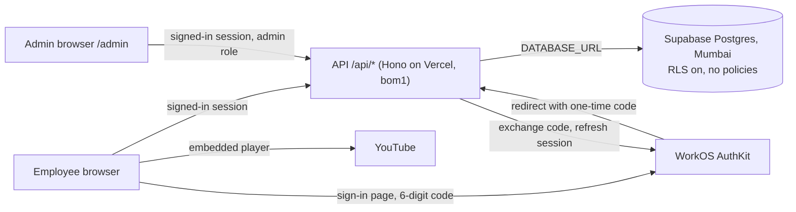

# Learning Platform — Architecture (V1 pilot)

**Status:** Approved scope for the V1 pilot · **Last updated:** 3 Nov 2026

---

## 1. Overview

An internal learning platform. Employees sign in with their company account, see a dashboard of courses, enroll (or are enrolled by an admin), watch the course videos, and then take the course's assessment. Each video must be watched to at least 80% before the next one unlocks, and the assessment unlocks when every video is done. Employees see only their score. Admins build courses, assign them, and track progress and results.

The first course is *Email Etiquette*, built from a YouTube video.

### In scope (V1 pilot)

- Sign-in for employees and admins with their company email, through **WorkOS AuthKit** (a 6-digit code sent by email; section 4.3)
- Course catalog, self-enrollment, and admin assignment by email
- Courses made of ordered YouTube videos plus one assessment
- Watch tracking: each video must reach 80%, in order, before the next unlocks
- One assessment per course, single-choice and multiple-choice questions, autosave and resume
- Automatic scoring; employees see their score only
- One attempt per course for the pilot (the setting exists so retakes can be turned on later)
- Admin course builder, tracking, per-person reports, stats, CSV export
- Basic activity log

### Out of scope (V1 pilot)

- Any email we send ourselves (invites, reminders, notifications). Sign-in codes are sent by WorkOS
- Employee CSV upload
- Retakes (kept as a setting, fixed at 1)
- Video hosts other than YouTube, documents or slides as lessons
- Text-answer questions, certificates, question pools, proctoring
- Showing employees pass/fail, correct answers or which questions they got wrong
- HRMS integration (section 15 keeps the design open for it)

---

## 2. Tech stack

| Layer | Choice | Notes |
|---|---|---|
| Frontend | React + Vite + TypeScript, React Router | One app: employee pages and `/admin/*` |
| API | Node + TypeScript, built with Hono, running as Vercel Functions | Same domain as the site, under `/api/*`. Zod validates every request body |
| Database | Supabase, used **only** as managed Postgres | RLS on every table, no direct browser access. No Supabase Storage, Realtime or table access from `supabase-js` |
| Database driver | `postgres` (postgres.js) over Supabase's connection pooler | Plain SQL; works with any Postgres host |
| Sign-in | WorkOS AuthKit, Magic Auth only (`@workos-inc/node` in the API) | WorkOS hosts the sign-in page and emails the codes from its own domain, so no DNS is needed. Free up to 1M monthly users. Behind one "who is this?" step in the API |
| Video | YouTube embedded player (IFrame Player API, `youtube-nocookie.com`) | Watch progress is read from the player |
| Hosting | Vercel (one project, one domain), function region `bom1` (Mumbai) | Same region as the database. Hobby is for non-commercial use, so move to Pro before rollout |
| Migrations | Supabase CLI (`supabase/migrations/`) | Plain SQL files |

### Dependencies (approved)

| Package | Where | Purpose |
|---|---|---|
| `hono` | API | Routing and middleware |
| `postgres` | API | Postgres driver |
| `zod` | API | Request validation |
| `@workos-inc/node` | API | WorkOS sign-in (added with the sign-in step) |
| `@hono/node-server`, `tsx` | API, dev only | Run the API locally |
| `react`, `react-dom`, `react-router-dom`, `vite`, `typescript`, `eslint` | Frontend | Already installed |

Any other package needs approval first (`AGENTS.md` section 5).

**Portability:** the Hono app in `server/` uses only web-standard `Request`/`Response` and plain SQL. Only `api/index.ts` knows about Vercel. Moving host means a new entry file and a new `DATABASE_URL`, not a rewrite.

### Environment variables

| Variable | Where | Purpose |
|---|---|---|
| `DATABASE_URL` | Vercel, server only, Sensitive | Supabase pooler connection string (transaction mode, port 6543). Full database access. **Never** in the frontend |
| `APP_BASE_URL` | Vercel, server only | The site's public URL |
| `ALLOWED_EMAIL_DOMAINS` | Vercel, server only, all environments | Company domains allowed to sign in (comma-separated). Set to `transfunnel.com` |
| `WORKOS_API_KEY` | Vercel, server only, Sensitive | WorkOS secret key (`sk_…`) |
| `WORKOS_CLIENT_ID` | Vercel, server only | WorkOS client id (`client_…`) |
| `WORKOS_COOKIE_PASSWORD` | Vercel, server only, Sensitive | 32+ random characters; encrypts the session cookie |
| `TEST_SIGNIN` | Vercel **Preview only**, and local | `on` enables test sign-in (section 4.2). Ignored in production |

The WorkOS variables are needed in Production (and locally if you test real sign-in); previews use test sign-in. `ADMIN_PASSWORD`, `SUPABASE_SECRET`, `PUBLISHABLE_KEY` and `PROJECT_URL` are not used by this design.

The frontend needs **no** environment variables. Anything prefixed `VITE_` is bundled into the browser, so never give a server variable a `VITE_` prefix.

---

## 3. System diagram



```
Employee:  Sign in ─► Dashboard ─► Course list ─► Enroll ─► Video 1 ≥80% ─► Video 2 ≥80% ─► … ─► Assessment ─► Score
Admin:     Sign in ─► Build course (videos + questions) ─► Publish ─► Assign by email ─► Track ─► Report / Export
```

The browser never reads or writes database tables. Every request goes through the API, which first works out who the signed-in user is (section 4).

---

## 4. Identity and sign-in

### 4.1 One "who is this?" step

Every API request (except `GET /api/health`) first calls `getCurrentUser()` in `server/lib/identity.ts`. It returns the signed-in user's row from `users`, or nothing.

- Employee routes require a user. Admin routes require a user with `role = 'admin'`.
- No other code knows how sign-in works. Changing sign-in method later (for example, adding Microsoft sign-in) means changing only `identity.ts` and the `server/auth/` routes.
- The browser never sends a user id. Everything is scoped to the user `getCurrentUser()` returns.

**Users are ours, not WorkOS's.** The `users` table holds email, name and role. The WorkOS user id goes into `users.auth_subject`. On first sign-in a user is matched by email (trimmed, lower-case); after that, by `auth_subject`.

- Only addresses in `ALLOWED_EMAIL_DOMAINS` can sign in or be assigned.
- A person assigned by email before they ever sign in gets a `users` row straight away. Their enrollment is waiting for them when they first sign in.
- The first admin is set by a person with one SQL statement after the first migration (`update users set role = 'admin' where email = …`). After that, admins promote others from the admin screens.

### 4.2 Test sign-in (previews and local only)

So the team can build and test everything without WorkOS, and on preview deployments (whose addresses change, so they can't be registered with WorkOS):

- **Enabled only when both are true:** `TEST_SIGNIN = on`, and the deployment is not production (`VERCEL_ENV` is `preview`, or the app is running locally). In production it is off whatever the variables say, and the app shows "Sign-in is not available yet".
- On a preview deployment, the sign-in page offers "Test sign-in": enter an allowed email address. The browser keeps it in `sessionStorage` and sends it on every API call as the `x-test-user` header; `identity.ts` loads (or creates) that user. There is no test-sign-in route and no cookie.
- Preview deployments are behind Vercel login (Standard Protection), so only the team can reach them.
- **Known risk:** previews and production share one database, so test sign-in can act as any user on preview. That is acceptable only while there is no real data. **Before the pilot, either give previews their own database or turn `TEST_SIGNIN` off.**

### 4.3 Real sign-in: WorkOS AuthKit

**Decision:** WorkOS AuthKit with **Magic Auth only** (no passwords, no social sign-in for now). The person enters their email on the WorkOS-hosted page, WorkOS emails a 6-digit code (valid 10 minutes), and the person types it in. A code is not used up by email scanners the way a one-time link is.

Chosen because we can't add DNS records to `transfunnel.com`, so we can't send email ourselves. Rejected: Resend or Supabase Auth email (need DNS or are capped at about 2 emails/hour), Clerk (production needs our own domain's DNS), Firebase (5 sign-in emails/day on the free plan), email and password without verification (anyone could sign in as anyone).

**Flow**

```
/signin ─► GET /api/auth/signin ─► WorkOS page: email ─► code by email ─► enter code
       ─► GET /api/auth/callback?code&state ─► API exchanges the code with WorkOS
       ─► domain check ─► upsert users ─► encrypted session cookie ─► redirect to /
```

1. `GET /api/auth/signin` creates a random `state`, stores it in a short-lived HttpOnly cookie, and redirects to the WorkOS authorization URL (provider `authkit`, redirect `{APP_BASE_URL}/api/auth/callback`).
2. `GET /api/auth/callback` checks `state` against the cookie, then calls `authenticateWithCode` with sealing on. WorkOS returns the user (id, email, name, email verified) and an encrypted ("sealed") session.
3. **Domain check:** the email's domain must be in `ALLOWED_EMAIL_DOMAINS`, and the email must be verified. Otherwise no session is created and the person sees "Use your company email".
4. The API upserts the `users` row (match `auth_subject`, else email), sets `auth_subject` and `first_signed_in_at`, and logs `user.signed_in`.
5. It sets the session cookie `wos-session`: HttpOnly, Secure, `SameSite=Lax`, `Path=/`, and redirects to `/`.
6. On every request, `getCurrentUser()` opens the sealed session with `WORKOS_COOKIE_PASSWORD`. If the access token has expired it refreshes it with WorkOS and re-sets the cookie; if the refresh fails, the user is signed out. It then loads the `users` row by `auth_subject`.
7. `POST /api/auth/signout` clears the cookie and redirects to WorkOS's logout URL, which ends the WorkOS session too.

**Rules**

- The browser never sees WorkOS tokens; it only holds the encrypted, HttpOnly cookie.
- Because the session is a cookie, every non-GET API request must carry an `Origin` header whose host matches the host the request was sent to (the site's own domain), or it is refused (protection against cross-site requests), on top of `SameSite=Lax`.
- Roles live in our `users` table, not in WorkOS.
- WorkOS may create its own user record for someone outside the allowed domains before our callback refuses them. They get no access to our app; such records can be deleted in the WorkOS dashboard. If WorkOS offers a domain restriction setting, turn it on as well.
- WorkOS stores names and emails, likely in the US. Confirm this is acceptable before the pilot (section 13, step 10).

**WorkOS dashboard setup (done by a person)**

- Authentication methods: **Magic Auth on**; passwords and social sign-in off.
- Redirect URI: `https://internal-assessment-tool.vercel.app/api/auth/callback` (production environment). For local testing of real sign-in, add `http://localhost:5173/api/auth/callback` in the WorkOS staging environment and use its keys locally.
- Sign-out redirect: `https://internal-assessment-tool.vercel.app/signin`.
- Branding: company name and logo on the hosted page.
- Session length: set in the WorkOS dashboard; a person who leaves can't receive new codes once their mailbox is closed, and their session ends at that limit.

**Later:** "Sign in with Microsoft" can be switched on in WorkOS once IT registers an app in Microsoft Entra. Nothing else changes.

---

## 5. How it works

| # | Step | Screen | API | Tables |
|---|---|---|---|---|
| 1 | Admin creates a draft course: title, description, pass %, optional due date | Admin › Course editor | `POST /admin/courses`, `PUT /admin/courses/:id` | `courses` |
| 2 | Admin adds YouTube videos in order; each is checked as embeddable and its length is read | Admin › Course editor › Videos | `POST /admin/videos/check`, `PUT /admin/courses/:id/videos` | `videos` |
| 3 | Admin adds questions and options, then publishes (the course becomes read-only) | Admin › Course editor › Assessment | `PUT /admin/courses/:id/questions`, `POST /admin/courses/:id/publish` | `questions`, `options` |
| 4 | Admin assigns the course to people by email | Admin › Course › Assign | `POST /admin/courses/:id/assign` | `users`, `enrollments` |
| 5 | Employee signs in and sees the dashboard: enrolled courses and the course list | Dashboard | `GET /me`, `GET /courses` | `users`, `courses`, `enrollments` |
| 6 | Employee enrolls in a published course | Course page | `POST /courses/:id/enroll` | `enrollments` |
| 7 | Employee watches videos in order; progress is saved every ~15 s and on pause or leaving the page; playback resumes where it stopped | Course › Video | `GET /courses/:id`, `POST /videos/:id/progress` | `video_progress` |
| 8 | When every video is ≥ 80%, the assessment unlocks; employee starts it; each answer saves immediately | Course › Assessment | `POST /courses/:id/attempt`, `GET /attempts/:id`, `PUT /attempts/:id/answers` | `attempts`, `answers` |
| 9 | Employee submits; the score is calculated and shown | Course › Result | `POST /attempts/:id/submit` | `attempts`, `answers`, `enrollments` |
| 10 | Admin tracks enrollments, video progress and scores; views reports and stats; exports CSV | Admin › Tracking, Reports | `GET /admin/courses/:id/tracking`, `GET /admin/enrollments/:id/report`, `GET /admin/courses/:id/stats`, `GET /admin/courses/:id/export` | all |

---

## 6. Database

Ten tables.

```
users ──┐                                   ┌──< videos
        ├──< enrollments >── courses ───────┤
        │        │                          └──< questions ──< options
        │        ├──< video_progress >── videos
        │        └──< attempts ──< answers
activity_log (references users / courses / enrollments by id)
```

### 6.1 Schema

```sql
create extension if not exists pgcrypto;

-- People. Ours, not the sign-in provider's (section 4.1).
create table users (
  id                  uuid primary key default gen_random_uuid(),
  email               text not null unique,          -- trimmed + lower-case
  full_name           text,
  role                text not null default 'learner'
                      check (role in ('learner', 'admin')),
  employee_code       text unique,                   -- optional; HRMS join key later (section 15)
  auth_subject        text unique,                   -- WorkOS user id, set on first real sign-in
  first_signed_in_at  timestamptz,
  created_at          timestamptz not null default now()
);

-- One course = ordered videos + one assessment. To change a published course, duplicate it.
create table courses (
  id               uuid primary key default gen_random_uuid(),
  title            text not null,
  description      text,
  pass_percentage  int  not null check (pass_percentage between 1 and 100),  -- admin-only
  max_attempts     int  not null default 1 check (max_attempts >= 1),       -- 1 for the pilot
  due_at           timestamptz,                       -- optional; none for the pilot
  status           text not null default 'draft'
                   check (status in ('draft', 'published', 'archived')),
  created_by       uuid references users(id),
  published_at     timestamptz,
  created_at       timestamptz not null default now()
);

create table videos (
  id                uuid primary key default gen_random_uuid(),
  course_id         uuid not null references courses(id) on delete cascade,
  position          int  not null,
  title             text not null,
  youtube_video_id  text not null,
  duration_seconds  int  not null check (duration_seconds > 0),
  unique (course_id, position)
);

create table questions (
  id         uuid primary key default gen_random_uuid(),
  course_id  uuid not null references courses(id) on delete cascade,
  position   int  not null,
  text       text not null,
  type       text not null check (type in ('single', 'multiple')),
  points     int  not null default 1 check (points > 0),
  unique (course_id, position)
);

create table options (
  id           uuid primary key default gen_random_uuid(),
  question_id  uuid not null references questions(id) on delete cascade,
  position     int  not null,
  text         text not null,
  is_correct   boolean not null default false,       -- never sent to learners
  unique (question_id, position)
);

-- One row per person per course.
create table enrollments (
  id               uuid primary key default gen_random_uuid(),
  course_id        uuid not null references courses(id),
  user_id          uuid not null references users(id),
  source           text not null check (source in ('self', 'admin')),
  assigned_by      uuid references users(id),
  status           text not null default 'enrolled'
                   check (status in ('enrolled', 'videos_done', 'assessment_in_progress', 'completed')),
  attempts_used    int not null default 0,
  best_score_pct   numeric(5,2),
  completed_at     timestamptz,
  created_at       timestamptz not null default now(),
  unique (course_id, user_id)
);

-- Watch progress per person per video (section 9.1).
create table video_progress (
  enrollment_id          uuid not null references enrollments(id),
  video_id               uuid not null references videos(id),
  watched                bit varying not null,         -- one bit per 5-second segment
  watched_segments       int  not null default 0,
  last_position_seconds  int  not null default 0,
  last_reported_at       timestamptz,
  completed_at           timestamptz,                  -- set once watched_segments reach 80%
  primary key (enrollment_id, video_id)
);

create table attempts (
  id             uuid primary key default gen_random_uuid(),
  enrollment_id  uuid not null references enrollments(id),
  attempt_no     int  not null,
  status         text not null default 'in_progress'
                 check (status in ('in_progress', 'submitted')),
  submit_reason  text check (submit_reason in ('learner', 'due_date')),
  started_at     timestamptz not null default now(),
  submitted_at   timestamptz,
  score_points   int,
  max_points     int,
  score_pct      numeric(5,2),
  passed         boolean,                              -- admin-only
  unique (enrollment_id, attempt_no)
);

-- At most one open attempt per enrollment: blocks duplicates from refreshes and extra tabs
create unique index one_open_attempt_per_enrollment
  on attempts (enrollment_id) where status = 'in_progress';

create table answers (
  id                   uuid primary key default gen_random_uuid(),
  attempt_id           uuid not null references attempts(id),
  question_id          uuid not null references questions(id),
  selected_option_ids  uuid[] not null default '{}',
  is_correct           boolean,                       -- set at submit; admin-only
  points_awarded       int,                           -- set at submit; admin-only
  saved_at             timestamptz not null default now(),
  unique (attempt_id, question_id)
);

create table activity_log (
  id             bigint generated always as identity primary key,
  actor_user_id  uuid,                                -- null for 'system'
  action         text not null,    -- e.g. 'course.published', 'enrollment.created', 'video.completed', 'attempt.submitted'
  course_id      uuid,
  enrollment_id  uuid,
  details        jsonb,
  created_at     timestamptz not null default now()
);
```

Values shown in the UI that are not stored:

- **Overdue:** a due date is set, `now() > due_at`, and the enrollment is not `completed`.
- **Video locked:** an earlier video in the course has no `completed_at`.
- **Assessment locked:** any video in the course has no `completed_at`.

### 6.2 Row Level Security

**Rule: the public (anon) key can read and write nothing.** RLS is enabled on every table and **no policies are created on purpose**. Only the API can access data. It connects with `DATABASE_URL` as the owner role (`postgres`), which owns the tables and bypasses RLS, so `DATABASE_URL` is as sensitive as a service role key. The app never uses Supabase's Data API or the anon key; keep the Data API off in Supabase settings, and keep the revokes below anyway.

```sql
-- 1. Enable RLS on every table. No policies = no access for anon/authenticated.
alter table users          enable row level security;
alter table courses        enable row level security;
alter table videos         enable row level security;
alter table questions      enable row level security;
alter table options        enable row level security;
alter table enrollments    enable row level security;
alter table video_progress enable row level security;
alter table attempts       enable row level security;
alter table answers        enable row level security;
alter table activity_log   enable row level security;

-- 2. Belt and braces: remove table and sequence privileges from the public roles.
revoke all on all tables    in schema public from anon, authenticated;
revoke all on all sequences in schema public from anon, authenticated;

-- 3. Make future tables and functions private by default.
alter default privileges in schema public revoke all on tables    from anon, authenticated;
alter default privileges in schema public revoke all on sequences from anon, authenticated;
alter default privileges in schema public revoke execute on functions from public, anon, authenticated;
```

**Database functions are the most common RLS leak.** Postgres lets everyone execute a new function by default, and Supabase's Data API exposes functions as endpoints. For every function you create:

```sql
revoke execute on function start_attempt(uuid) from public, anon, authenticated;
-- repeat for every function. No grant is needed: the API connects as the owner role.
```


#### RLS verification checklist (run before every release)

- [ ] Supabase dashboard › Advisors › Security shows no "RLS disabled" warnings.
- [ ] Using only the anon key, `select * from <table>` returns an error or zero rows for **each** of the 10 tables.
- [ ] Using only the anon key, `insert`/`update`/`delete` fails on each table.
- [ ] Using only the anon key, calling each database function through `rpc()` returns *permission denied*.
- [ ] The frontend build contains no server secrets (search the built JS for `postgres://` and `DATABASE_URL`).
- [ ] In the browser network tab during a course, no response contains `is_correct`, `points_awarded`, `passed` or `pass_percentage`.
- [ ] Signed in as learner A, no request returns learner B's enrollments, progress or attempts.
- [ ] On the production URL, test sign-in is refused.
- [ ] Signing in with an email outside `ALLOWED_EMAIL_DOMAINS` creates no session.
- [ ] A POST to the API from another origin is refused.

---

## 7. API

One Hono app (`server/app.ts`), run on Vercel through a single entry file, `api/index.ts`. Shared code lives in `server/lib/` (`db.ts`, `identity.ts`, `workos.ts`, `youtube.ts`, `csv.ts`).

- **Sign-in routes:** `/api/auth/*`, in `server/auth/`. No sign-in required.

- **Learner routes:** `/api/*`, in `server/learner/`. Middleware: a signed-in user is required.
- **Admin routes:** `/api/admin/*`, in `server/admin/`. Middleware: a signed-in user with `role = 'admin'` is required.
- Each group has a thin `index.ts` that runs its check once, then hands off to a handler in its `routes/` folder (one file per area). No handler runs before the check.
- Every route validates its request body with Zod.
- Learner routes **never** return `options.is_correct`, `answers.is_correct`, `answers.points_awarded`, `attempts.passed` or `courses.pass_percentage`.
- The site and the API share one domain, so no CORS headers are sent. Every non-GET request must have an `Origin` matching the site's own host (`server/lib/origin.ts`).

### 7.1 Public

| Method & path | Purpose |
|---|---|
| `GET /api/health` | `{ ok, db, testSignin }`: checks the database connection (503 when it is down) and says whether test sign-in is on, so the sign-in page knows whether to offer it. No user data |

### 7.1a Sign-in (`/api/auth`)

| Method & path | Purpose |
|---|---|
| `GET /auth/signin` | Redirect to the WorkOS sign-in page (section 4.3) |
| `GET /auth/callback` | WorkOS returns here; exchange the code, check the domain, create the session cookie, redirect to `/` |
| `POST /auth/signout` | Clear the session cookie and redirect to WorkOS's logout URL |

### 7.2 Learner (`/api`)

| Method & path | Purpose |
|---|---|
| `GET /me` | The signed-in user: name, email, role |
| `GET /courses` | Published courses, each with my enrollment state (not enrolled / in progress / completed) and my score if completed |
| `POST /courses/:id/enroll` | Enroll myself in a published course. Idempotent |
| `GET /courses/:id` | For an enrolled course: videos in order with my progress, lock state and resume position; assessment state (locked / available / in progress / completed) and my score |
| `POST /videos/:id/progress` | Body: `{ segments: int[], position: int }`. Records watched segments (section 9.1). Returns my progress for that video |
| `POST /courses/:id/attempt` | Start the assessment, or return the open attempt. Refused unless every video is complete and attempts remain |
| `GET /attempts/:id` | Questions and options (**no correct answers**) and my saved answers |
| `PUT /attempts/:id/answers` | Body: `{ question_id, selected_option_ids[] }`. Upserts one answer |
| `POST /attempts/:id/submit` | Body: all answers (final snapshot). Scores and returns `{ score_pct }` only |

Every route checks that the course, video or attempt belongs to an enrollment of the signed-in user.

### 7.3 Admin (`/api/admin`)

| Method & path | Purpose |
|---|---|
| `GET /courses` | All courses with counts (enrolled, completed, average score) |
| `POST /courses` | Create a draft |
| `GET /courses/:id` | Course with videos, questions and options (including correct answers) |
| `PUT /courses/:id` | Update title, description, pass %, due date (draft only) |
| `POST /videos/check` | Body: `{ url }`. Returns the YouTube id and title, and whether the video can be embedded |
| `PUT /courses/:id/videos` | Replace the ordered video list, with each video's duration (draft only) |
| `PUT /courses/:id/questions` | Replace all questions and options (draft only) |
| `POST /courses/:id/publish` | Validate and lock. Needs ≥ 1 video, ≥ 1 question, every video still embeddable; single-choice has exactly 1 correct option, multiple-choice ≥ 1 |
| `POST /courses/:id/duplicate` | Copy as a new draft (the only way to change a published course) |
| `POST /courses/:id/archive` | Hide from the course list; enrolled learners keep their results |
| `POST /courses/:id/assign` | Body: `{ emails[] }`. Creates missing users (allowed domains only) and enrollments with `source = 'admin'`. Returns `{ enrolled, already_enrolled, rejected[] }` |
| `GET /users` | Search and list users |
| `PUT /users/:id/role` | Make a user an admin or a learner |
| `GET /courses/:id/tracking` | Enrollments with person, source, video progress, status, score, pass/fail |
| `GET /enrollments/:id/report` | Video progress and every attempt with every answer and correctness |
| `GET /courses/:id/stats` | Enrolled, videos done, completed, pass rate, average score, % correct per question |
| `GET /courses/:id/export` | CSV of results (section 9.6) |

---

## 8. Frontend

| Route | Screen |
|---|---|
| `/signin` | "Sign in with your company email" button (goes to `/api/auth/signin`); on previews, test sign-in instead. Shows "Use your company email" after a refused domain |
| `/` | Dashboard: my courses (progress, score) and the course list |
| `/courses/:id` | Course page: video list with progress and locks, the assessment card |
| `/courses/:id/videos/:videoId` | Video player with progress bar ("Watched 64% — 80% unlocks the next step") |
| `/courses/:id/assessment` | Questions with autosave, submit confirmation, score |
| `/admin/*` | Courses, course editor (details, videos, questions), assign, tracking, reports, users |

All server calls go through `web/src/api/learnerApi.ts` and `web/src/api/adminApi.ts`.

---

## 9. Core rules

### 9.1 Video watch tracking

- **Segments:** each video is split into 5-second segments. `videos.duration_seconds` is read from the YouTube player in the admin's browser when the video is added.
- **Browser:** while the video is playing and the tab is visible, the page records which segments the playhead passes through. It reports them every ~15 s, on pause, on end, and when the page is hidden or closed (`fetch` with `keepalive`).
- **Server (`record_video_progress` function, one transaction):**
  1. Rejects the report if the video is locked (an earlier video is not complete) or the course is past its due date.
  2. Credits only **new** segments, and at most as many as could have been played since the last report at 2× speed, plus one. A script cannot post "everything watched" in one call.
  3. Saves the resume position and the report time.
  4. Sets `completed_at` once `watched_segments * 100 >= 80 * total_segments`. Once complete, it stays complete.
  5. When the last video completes, sets the enrollment to `videos_done` and logs `video.completed` events.
- **Seeking is allowed** (no hidden controls; YouTube forbids covering its player). Skipped parts simply aren't credited. The page shows how much is watched and that 80% unlocks the next step.
- **Not counted:** playback in a hidden tab. Muted playback **is** counted (people watching with captions).
- **Player settings:** `youtube-nocookie.com`, `rel=0` (end suggestions only from the same channel), `playsinline=1`, `enablejsapi=1`.
- **Referrer:** YouTube refuses to play embeds without a `Referer` header (error 153). The site uses `Referrer-Policy: strict-origin-when-cross-origin`, which sends only our domain to YouTube.
- **Unavailable video:** if the player reports an error, the page shows "This video is unavailable. Contact HR." and the API logs it. The admin is warned at publish if a video is no longer embeddable.

### 9.2 Attempts

Starting and submitting are Postgres functions that the API calls with plain SQL. Each runs as one transaction.

**`start_attempt(enrollment_id)`**

1. If an `in_progress` attempt exists, return it (resume).
2. Otherwise check: course is `published`, not past `due_at`, every video complete, `attempts_used < max_attempts`.
3. Insert the attempt with `attempt_no = attempts_used + 1`, increment `attempts_used`, and set the enrollment to `assessment_in_progress`.
4. The unique index on open attempts guarantees two simultaneous Start clicks create only one attempt.

**Saving answers:** the browser saves each answer as soon as it changes (debounced ~500 ms) and shows *Saved / Saving… / Not saved*. Failed saves retry. The server rejects saves unless the attempt is `in_progress` and not past the due date, and checks every option id belongs to that question.

**`submit_attempt(attempt_id, answers)`**

1. Lock the attempt row (`select … for update`).
2. If already `submitted`, return the stored score (double-clicks and second tabs are harmless).
3. Upsert the final answers.
4. Score every question (9.3) and write `is_correct` and `points_awarded`.
5. Write `score_points`, `max_points`, `score_pct`, `passed`, `submitted_at`, `status = 'submitted'`.
6. Update the enrollment: `best_score_pct`, `status = 'completed'`, `completed_at`.
7. Insert an `activity_log` row.

### 9.3 Scoring

- **Single-choice:** correct if the one selected option is the correct option.
- **Multiple-choice:** correct only if the selected set exactly equals the set of correct options (all-or-nothing).
- **Unanswered:** 0 points. The UI warns "*N* questions unanswered — submit anyway?"
- `score_pct = round(score_points * 100.0 / max_points, 2)`
- `passed = (score_points * 100 >= pass_percentage * max_points)` (integers, so boundaries are exact). Stored for admins only.
- With retakes turned on later, the enrollment's result is its **best** attempt.

### 9.4 What learners see

Their score % and the date, per course. **Never** pass/fail, the pass mark, which questions were right or wrong, or the correct answers. Enforced by the API, not just hidden in the UI.

### 9.5 Due dates and auto-submit

Due dates are optional (none for the pilot). When set: after `due_at`, videos and the assessment are read-only and the learner sees their results only. An attempt left open at the due date is submitted automatically **on demand** with its saved answers (`submit_reason = 'due_date'`), by `auto_submit_overdue(course_id)`, which runs at the start of learner requests for that course and admin tracking, report, stats and export requests. No scheduled job.

### 9.6 Export

One row per enrollment: name, email, employee code, source, enrolled at, videos completed, status, score %, passed, completed at. Any cell starting with `=`, `+`, `-` or `@` is prefixed with `'`, so Excel won't treat it as a formula.

### 9.7 Editing after publishing

Published courses are read-only. To change videos or questions, duplicate the course, edit the copy, publish it and assign it. Archive the old one. This keeps every stored score explainable.

---

## 10. Security summary

| Area | Rule |
|---|---|
| Database access | RLS on all tables, no policies, privileges revoked from anon and authenticated (6.2) |
| Database functions | `execute` revoked from public, anon and authenticated; only the owner role used by the API can run them |
| Secrets | `DATABASE_URL`, `WORKOS_API_KEY` and `WORKOS_COOKIE_PASSWORD` only in Vercel server variables; the frontend has none; the repo is public |
| Sign-in | WorkOS Magic Auth codes; company domains only; encrypted HttpOnly `SameSite=Lax` session cookie; `state` checked on callback; `Origin` checked on every non-GET request |
| Identity | One `getCurrentUser()` step on every request; learners only ever see their own data; admin routes need `role = 'admin'` |
| Test sign-in | Preview and local only; never in production; turned off (or previews given their own database) before the pilot |
| Answer key | Never returned to learners; scoring runs in the database |
| Results | Learners see their score only |
| Watch tracking | Server-side limit on credit per report; video order enforced on the server |
| Files | Export escaped against formula injection |
| Transport | HTTPS only; `Referrer-Policy: strict-origin-when-cross-origin`; the only third-party script is YouTube's player, on video pages |
| Audit | `activity_log` records sign-in, publish, duplicate, archive, assign, enroll, role change, video completed, attempt start and submit, export |

---

## 11. Edge cases

| Case | Handling |
|---|---|
| Refresh or browser closed during a video | Playback resumes at the saved position; watched segments are kept |
| Skipping ahead in a video | Allowed; skipped parts aren't credited |
| Playing at 2× | Credited normally; faster than 2× is credited more slowly |
| Video left playing in a background tab | Not credited |
| Two tabs on the same video | Both report; segments are merged, the server limit still applies |
| Refresh during the assessment | Resumes the same attempt with saved answers |
| Network drop | Video reports and answers retry; submit sends all answers as a final snapshot |
| Double submit | `submit_attempt` returns the stored score |
| Enroll twice | Idempotent; one enrollment |
| Admin assigns someone already self-enrolled | Counted as `already_enrolled`; nothing changes |
| Assigned email outside allowed domains | Rejected and listed in the response |
| Assigned person hasn't signed in yet | Their user row and enrollment wait for first sign-in |
| YouTube video removed or made private | Player error shows "Video unavailable. Contact HR."; publish re-checks embeddability |
| Course changed after enrollments | Not possible; published courses are locked |
| Learner tries another learner's data | Impossible through the API; every query is scoped to the signed-in user |
| Sign-in code expired or mistyped | Handled on the WorkOS page; the person requests a new code |
| Email outside allowed domains | No session; "Use your company email" |
| Sign-in code lands in junk | Tell staff in advance; IT can allowlist the WorkOS sender (a mail setting, no DNS) |
| WorkOS is down | Nobody can sign in; people already signed in continue until their access token needs refreshing |
| Session expires mid-assessment | Saved answers are kept; after signing in again the attempt resumes |

---

## 12. Folder structure

```
/
├── web/                          # React + Vite frontend
│   └── src/
│       ├── pages/
│       │   ├── learner/          # SignIn, Dashboard, Course, Video, Assessment
│       │   └── admin/            # Courses, CourseEditor, Assign, Tracking, Reports, Users
│       ├── api/                  # learnerApi.ts, adminApi.ts (fetch wrappers)
│       ├── components/           # VideoPlayer (YouTube + tracking), ...
│       └── lib/
├── api/
│   └── index.ts                  # Vercel entry: hands every /api/* request to the Hono app
├── server/                       # the Hono app; no Vercel-specific code
│   ├── app.ts                    # mounts health, auth, learner and admin routes
│   ├── auth/                     # signin, callback, signout
│   ├── learner/
│   │   ├── index.ts              # signed-in check, then routes to a handler
│   │   └── routes/               # courses, videos, attempts
│   ├── admin/
│   │   ├── index.ts              # admin check, then routes to a handler
│   │   └── routes/               # courses, videos, questions, assign, users, reports
│   ├── dev.ts                    # local API server (Node), used by npm run dev:api
│   └── lib/                      # config.ts, db.ts, email.ts, identity.ts, origin.ts, workos.ts, youtube.ts, csv.ts
├── supabase/
│   ├── migrations/               # schema, RLS, database functions (SQL)
│   └── seed.sql                  # sample course and test users; LOCAL database only (never run on Supabase)
├── package.json                  # API dependencies and scripts (web/ has its own)
├── tsconfig.json, eslint.config.js  # API typecheck and lint
├── .env.example                  # local API settings (copy to .env, git-ignored)
├── vercel.json                   # build web/, route /api/* to api/index.ts, region bom1
└── architecture.md
```

---

## 13. Team and execution plan

Everyone works across all modules; anyone can pick up any step.

**Working agreements**

1. Agree on the schema (section 6) and the endpoint list (section 7) before feature work. The frontend can build against mocked responses.
2. **Until V1, commits go straight to `main`** (no pull requests), each after its checks pass and with a row in `progress.md`. Every push deploys to production. Changes to migrations, `server/lib/identity.ts`, `server/auth/` or the learner routes: ask whether a teammate should look at the diff before pushing. After V1, the team returns to branches and pull requests with CODEOWNERS review. Commit and progress rules are in `AGENTS.md`.
3. Hosted migrations are applied only from an up-to-date `main`, after the commit that adds them is pushed. Anyone on the team can apply them, after asking.
4. One Supabase project for now (previews and production share it). Create a separate production project before the real rollout.

**Execution plan**

| # | Step | Depends on |
|---|---|---|
| 1 | This design | — |
| 2 | API scaffold: Hono app, Vercel entry, `vercel.json` (region `bom1`), `GET /api/health`, `getCurrentUser()` with test sign-in, Deno stubs removed. Then Vercel's Root Directory is cleared | 1 |
| 3 | CI: typecheck, lint, build; migrations against a test Postgres; RLS checks; `progress.md` check, run on every push to `main`. Until V1, branch protection only blocks force pushes and deleting `main` | 2 |
| 4 | Schema, RLS and database functions; seed data | 1 |
| 5 | Admin course builder: details, videos, questions, publish, duplicate | 4 |
| 6 | Learner: dashboard, course list, enroll, video player with tracking | 4 |
| 7 | Assessment: unlock, start, autosave, submit, score | 6 |
| 8 | Admin: assign, tracking, reports, stats, export, users | 5, 7 |
| 9 | WorkOS sign-in (section 4.3): `server/auth/` routes, WorkOS version of `getCurrentUser()`, sign-in page | WorkOS account, keys in Vercel, redirect URI set |
| 10 | Pilot readiness: edge cases (section 11), RLS checklist, Vercel Pro, separate production database or `TEST_SIGNIN` off, WorkOS data location confirmed, sign-in email deliverability checked, pilot with one team | All |

Steps 5 and 6–7 can run in parallel.

---

## 14. Later (not in the pilot)

- Retakes (`max_attempts` > 1), extra attempts or later due dates for one person
- Emails: enrollment notices, reminders
- Employee CSV upload
- Other video hosts (Vimeo, uploaded video), documents and slides as lessons, questions inside videos
- Courses without an assessment, certificates
- Text-answer questions, question shuffling and pools
- Manager views of team results

---

## 15. V2: HRMS integration (planned, not built)

**The pilot builds nothing for HRMS.** This section records what V2 is likely to add and which choices already keep that easy.

| Capability | How it would work |
|---|---|
| Employee sync | The HRMS sends the employee list; V2 upserts `users` by `employee_code` (or email) in one shared function |
| Sign-in | WorkOS sign-in already maps people to `users`; Microsoft sign-in can be added in WorkOS; the HRMS can link to course pages directly |
| Results to HRMS | `submit_attempt` is the single point where a result is produced; V2 sends it from there, or the HRMS pulls it |
| Automatic assignment | New joiners or departments are enrolled by rule instead of by hand |

**Conventions that keep this open**

1. Use `users.id` internally; use `employee_code` (when present) or email for anything external. Never identify people by name.
2. Keep identity in one module (`server/lib/identity.ts`).
3. Keep user creation and updates in one shared function (used by first sign-in and admin assign).
4. Write V2 changes as **new** migrations that add tables or columns; pilot tables are never reshaped or dropped.
