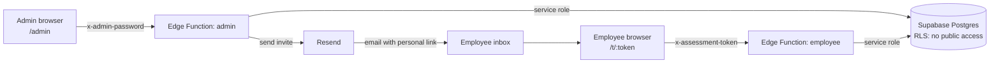

# Assessment Module — Architecture (V1)

**Status:** Approved scope for V1 · **Last updated:** 16 Oct 2026

---

## 1. Overview

A standalone tool for running internal assessments (for example, *Email Etiquette*). An admin creates a multiple-choice assessment, uploads employees, and emails each employee a personal link. Employees take the assessment without logging in, get an automatic score and pass/fail result, and can retake it if attempts remain. The admin tracks progress, views reports and exports results.

### In scope (V1)

- Admin access protected by one password (environment variable)
- Assessments with single-choice and multiple-choice questions
- Employee upload via CSV/Excel
- One personal link per employee per assessment, emailed through Resend
- Taking the assessment with autosave and resume
- Automatic scoring on submit; score and pass/fail shown to the employee
- Retakes up to a configured limit; every attempt stored separately
- Admin tracking, individual reports, overall stats, CSV export
- Basic activity log

### Out of scope (V1)

- HRMS integration (planned for V2; section 13 keeps the design open for it)
- Employee or admin login systems, SSO
- Text-answer questions
- Showing correct or incorrect answers to employees
- Certificates, learning content, proctoring, advanced analytics

---

## 2. Tech stack

| Layer | Choice | Notes |
|---|---|---|
| Frontend | React + Vite + TypeScript, React Router | One app with `/admin/*` and `/t/:token` routes |
| Backend | Supabase Edge Functions (TypeScript, Deno) | Two functions: `admin` and `employee` |
| Database | Supabase Postgres | RLS on every table, no direct browser access |
| Email | Resend (free tier) | Sent from a verified company subdomain |
| CSV/Excel parsing | SheetJS (`xlsx`) in the browser | Server re-validates every row |
| Hosting | Vercel or Netlify (static frontend) | Edge Functions are hosted by Supabase |

### Environment variables

| Variable | Where | Purpose |
|---|---|---|
| `VITE_SUPABASE_URL` | Frontend | Project URL |
| `VITE_SUPABASE_ANON_KEY` | Frontend | Public key. Used **only** to call Edge Functions |
| `SUPABASE_SERVICE_ROLE_KEY` | Edge Function secrets | Full database access. **Never** in the frontend |
| `ADMIN_PASSWORD` | Edge Function secrets | Long random string (20+ characters) |
| `RESEND_API_KEY` | Edge Function secrets | Email sending |
| `EMAIL_FROM` | Edge Function secrets | e.g. `HR Team <assessments@hr.yourcompany.com>` |
| `APP_BASE_URL` | Edge Function secrets | Used to build employee links |

> Anything prefixed `VITE_` is bundled into the browser. Never give the service role key a `VITE_` prefix.

---

## 3. System diagram



The browser never reads or writes database tables. Every request goes through an Edge Function, which checks the admin password or the employee's link token first.

---

## 4. How it works

| # | Step | Screen | Function call | Tables touched |
|---|---|---|---|---|
| 1 | Admin creates an assessment with 25–30 questions, pass %, max attempts and due date, then publishes it | Admin › Assessment editor | `POST /assessments`, `PUT /assessments/:id/questions`, `POST /assessments/:id/publish` | `assessments`, `questions`, `options` |
| 2 | Admin uploads employee CSV/Excel; invalid and duplicate rows are reported | Admin › Employees › Upload | `POST /employees/import` | `employees` |
| 3 | Admin assigns the assessment to employees; a unique link is created per employee | Admin › Assessment › Assign | `POST /assessments/:id/assign` | `assignments` |
| 4 | Tool emails each employee their link; admin can resend or revoke | Admin › Assessment › Tracking | `POST /assessments/:id/send-invites`, `POST /assignments/:id/resend`, `POST /assignments/:id/revoke` | `assignments`, `activity_log` |
| 5 | Employee opens the link and sees the title, rules and a Start button | Take › Landing | `GET /me` | `assignments`, `assessments`, `attempts` |
| 6 | Employee answers; each answer is saved immediately; reopening the link resumes | Take › Questions | `POST /attempts/start`, `GET /attempts/current`, `PUT /attempts/:id/answers` | `attempts`, `answers` |
| 7 | Employee submits; score and pass/fail are calculated and stored | Take › Questions | `POST /attempts/:id/submit` | `attempts`, `answers`, `assignments` |
| 8 | Employee sees score and result, past attempts, and Retake if allowed | Take › Result | `GET /me` | `attempts` |
| 9 | Admin tracks pending/completed, views reports and stats, exports CSV | Admin › Tracking, Reports | `GET /assessments/:id/tracking`, `GET /assignments/:id/report`, `GET /assessments/:id/stats`, `GET /assessments/:id/export` | all |

---

## 5. Database

Eight tables: seven for the core flow, plus `activity_log` for the audit trail.

```
employees ─┐
           ├─< assignments >── assessments ──< questions ──< options
           │        │
           │        └──< attempts ──< answers
activity_log (references assessments / assignments by id)
```

### 5.1 Schema

```sql
create extension if not exists pgcrypto;

-- People uploaded from CSV/Excel
create table employees (
  id             uuid primary key default gen_random_uuid(),
  employee_code  text not null unique,          -- text, so leading zeros survive
  full_name      text not null,
  email          text not null,                 -- stored trimmed + lower-case
  department     text,
  created_at     timestamptz not null default now(),
  updated_at     timestamptz not null default now()
);

-- One assessment = one run with its own rules. To re-run or change it, duplicate it.
create table assessments (
  id               uuid primary key default gen_random_uuid(),
  title            text not null,
  description      text,
  pass_percentage  int  not null check (pass_percentage between 1 and 100),
  max_attempts     int  not null default 1 check (max_attempts >= 1),
  due_at           timestamptz not null,
  status           text not null default 'draft'
                   check (status in ('draft', 'published', 'closed')),
  created_at       timestamptz not null default now()
);

create table questions (
  id             uuid primary key default gen_random_uuid(),
  assessment_id  uuid not null references assessments(id) on delete cascade,
  position       int  not null,
  text           text not null,
  type           text not null check (type in ('single', 'multiple')),
  points         int  not null default 1 check (points > 0),
  unique (assessment_id, position)
);

create table options (
  id           uuid primary key default gen_random_uuid(),
  question_id  uuid not null references questions(id) on delete cascade,
  position     int  not null,
  text         text not null,
  is_correct   boolean not null default false,   -- never sent to employees
  unique (question_id, position)
);

-- One row per employee per assessment. Holds the link token (hashed).
create table assignments (
  id               uuid primary key default gen_random_uuid(),
  assessment_id    uuid not null references assessments(id),
  employee_id      uuid not null references employees(id),
  token_hash       text unique,                  -- sha256 of the raw token
  token_revoked    boolean not null default false,
  status           text not null default 'pending'
                   check (status in ('pending', 'in_progress', 'passed', 'failed')),
  attempts_used    int not null default 0,
  best_score_pct   numeric(5,2),
  email_status     text not null default 'not_sent'
                   check (email_status in ('not_sent', 'sent', 'failed')),
  last_emailed_at  timestamptz,
  created_at       timestamptz not null default now(),
  unique (assessment_id, employee_id)
);

create table attempts (
  id             uuid primary key default gen_random_uuid(),
  assignment_id  uuid not null references assignments(id),
  attempt_no     int  not null,
  status         text not null default 'in_progress'
                 check (status in ('in_progress', 'submitted')),
  submit_reason  text check (submit_reason in ('employee', 'due_date')),
  started_at     timestamptz not null default now(),
  submitted_at   timestamptz,
  score_points   int,
  max_points     int,
  score_pct      numeric(5,2),
  passed         boolean,
  unique (assignment_id, attempt_no)
);

-- At most one open attempt per assignment: blocks duplicates from refreshes and extra tabs
create unique index one_open_attempt_per_assignment
  on attempts (assignment_id) where status = 'in_progress';

create table answers (
  id                   uuid primary key default gen_random_uuid(),
  attempt_id           uuid not null references attempts(id),
  question_id          uuid not null references questions(id),
  selected_option_ids  uuid[] not null default '{}',
  is_correct           boolean,                  -- set at submit; admin-only
  points_awarded       int,                      -- set at submit; admin-only
  saved_at             timestamptz not null default now(),
  unique (attempt_id, question_id)
);

create table activity_log (
  id             bigint generated always as identity primary key,
  actor          text not null check (actor in ('admin', 'employee', 'system')),
  action         text not null,    -- e.g. 'assessment.published', 'invite.sent', 'attempt.submitted'
  assessment_id  uuid,
  assignment_id  uuid,
  details        jsonb,
  created_at     timestamptz not null default now()
);
```

Status values shown in the UI that are not stored:

- **Overdue:** `pending` or `in_progress` and `now() > due_at`
- **Link revoked:** `token_revoked = true`

### 5.2 Row Level Security

**Rule: the public (anon) key can read and write nothing.** RLS is enabled on every table and **no policies are created on purpose**. Only Edge Functions, using the service role key, can access data. The service role key bypasses RLS.

```sql
-- 1. Enable RLS on every table. No policies = no access for anon/authenticated.
alter table employees    enable row level security;
alter table assessments  enable row level security;
alter table questions    enable row level security;
alter table options      enable row level security;
alter table assignments  enable row level security;
alter table attempts     enable row level security;
alter table answers      enable row level security;
alter table activity_log enable row level security;

-- 2. Belt and braces: remove table and sequence privileges from the public roles.
revoke all on all tables    in schema public from anon, authenticated;
revoke all on all sequences in schema public from anon, authenticated;

-- 3. Make future tables and functions private by default.
alter default privileges in schema public revoke all on tables    from anon, authenticated;
alter default privileges in schema public revoke all on sequences from anon, authenticated;
alter default privileges in schema public revoke execute on functions from public, anon, authenticated;
```

**Database functions are the most common RLS leak.** Postgres lets everyone execute a new function by default, and Supabase exposes functions as API endpoints. A `security definer` function also bypasses RLS. For every function you create:

```sql
revoke execute on function start_attempt(uuid)          from public, anon, authenticated;
grant  execute on function start_attempt(uuid)          to service_role;
-- repeat for submit_attempt, auto_submit_overdue, and any other function
```

#### RLS verification checklist (run before every release)

- [ ] Supabase dashboard › Advisors › Security shows no "RLS disabled" warnings.
- [ ] Using only the anon key, `select * from <table>` returns an error or zero rows for **each** of the 8 tables.
- [ ] Using only the anon key, `insert`/`update`/`delete` fails on each table.
- [ ] Using only the anon key, calling each database function through `rpc()` returns *permission denied*.
- [ ] The frontend build contains no service role key (search the built JS for `service_role` and the key prefix).
- [ ] In the browser network tab during an attempt, no response contains `is_correct` or `points_awarded`.
- [ ] Calling the employee function with employee A's token never returns employee B's data.

---

## 6. Edge Functions

There are two functions, each with internal routing (a small router such as Hono, or a `switch` on method and path). The shared code lives in `_shared/`.

In `admin`, `index.ts` is a thin router: it checks the admin password once, then hands the request to a handler in `admin/routes/` (one file per area, for example assessments, employees, invites, reports). No handler runs before the password check. This keeps parallel work on different areas out of one file.

Every function must:

- Return CORS headers for the frontend domain.
- Validate the request body before using it.
- Never return `options.is_correct`, `answers.is_correct` or `answers.points_awarded` from the **employee** function.

### 6.1 `admin` (header `x-admin-password`)

The first step of every request is a constant-time comparison of the header with `ADMIN_PASSWORD`. If it doesn't match, the function returns 401. The frontend asks for the password once and keeps it in `sessionStorage`, so it is cleared when the tab closes.

| Method & path | Purpose |
|---|---|
| `POST /login` | Check the password (frontend uses it to unlock the admin UI) |
| `GET /assessments` | List assessments with counts |
| `POST /assessments` | Create a draft |
| `GET /assessments/:id` | Assessment with questions and options (including correct answers) |
| `PUT /assessments/:id` | Update title, rules, due date (draft only) |
| `PUT /assessments/:id/questions` | Replace all questions and options (draft only) |
| `POST /assessments/:id/publish` | Validate and lock. Validation: ≥ 1 question; single-choice has exactly 1 correct option; multiple-choice has ≥ 1 |
| `POST /assessments/:id/duplicate` | Copy as a new draft (use this to change a published assessment) |
| `POST /assessments/:id/close` | Stop new attempts; open attempts are auto-submitted |
| `POST /employees/import` | Body: parsed rows. Returns `{inserted, updated, skipped, errors[]}` |
| `GET /employees` | Search and list |
| `POST /assessments/:id/assign` | Body: `employee_ids[]`. Creates assignments; skips existing |
| `POST /assessments/:id/send-invites` | Sends to every assignment with `email_status = 'not_sent'` |
| `POST /assignments/:id/resend` | Creates a **new** token, emails it; the old link stops working |
| `POST /assignments/:id/revoke` | Disables the link |
| `GET /assessments/:id/tracking` | Assignments with employee, status, attempts, best score, email status |
| `GET /assignments/:id/report` | All attempts with every answer and correctness (admin only) |
| `GET /assessments/:id/stats` | Assigned, completed, passed, pass rate, average score, % correct per question |
| `GET /assessments/:id/export` | CSV of results (see 7.8) |

### 6.2 `employee` (header `x-assessment-token`)

The first step of every request is to hash the token, find the assignment by `token_hash`, and reject the request if the token is not found or is revoked. Every query after that is filtered by **that** assignment's id. The function never accepts an employee id or assignment id from the browser.

| Method & path | Purpose |
|---|---|
| `GET /me` | Assessment title, description, rules, due date, employee first name, attempt history (number, date, score %, pass/fail), `can_start`, and `reason` if not |
| `POST /attempts/start` | Start a new attempt, or return the open one if it exists |
| `GET /attempts/current` | Questions and options (**no correct answers**), saved answers |
| `PUT /attempts/:id/answers` | Body: `{question_id, selected_option_ids[]}`. Upserts one answer |
| `POST /attempts/:id/submit` | Body: all answers (final snapshot). Scores and returns `{score_pct, passed}` |

---

## 7. Core rules

### 7.1 Personal links

- Token = 32 random bytes from `crypto.getRandomValues`, base64url-encoded.
- Only the SHA-256 hash is stored (`assignments.token_hash`). The raw token exists only in the email.
- Link format: `{APP_BASE_URL}/t/{token}`.
- A new token is generated every time an email is sent (invite or resend). The previous link stops working.
- The frontend reads the token from the URL, keeps it in memory, and sends it in the `x-assessment-token` header. It is never put in API query strings.
- Opening the link **does nothing by itself**. Starting an attempt needs a click on Start. This matters because company email scanners open links automatically.
- Set `Referrer-Policy: no-referrer` on the site, and don't add third-party analytics scripts to `/t/*` pages.

### 7.2 What the link allows over time

| Situation | Employee sees |
|---|---|
| Before due date, attempts remaining | Start / Continue / Retake |
| After due date, or assessment closed | Past attempts and results only |
| All attempts used, or already passed | Past attempts and results only |
| Link revoked or replaced | "This link is no longer valid. Contact HR." |
| Unknown token | Same message as revoked (no detail given) |

### 7.3 Attempts

Implement starting and submitting as Postgres functions (`start_attempt`, `submit_attempt`) called with `rpc()` from the Edge Function. `supabase-js` cannot run multi-step transactions, but a database function always runs as one transaction.

**`start_attempt(assignment_id)`**

1. If an `in_progress` attempt exists, return it (resume).
2. Otherwise check: assessment is `published`, `now() < due_at`, link not revoked, `attempts_used < max_attempts`, and status is not `passed`.
3. Insert the attempt with `attempt_no = attempts_used + 1`; increment `attempts_used`; set assignment status to `in_progress`.
4. The unique index on open attempts guarantees that two simultaneous Start clicks create only one attempt.

**Saving answers**

- The frontend saves each answer as soon as it changes (debounced around 500 ms) and shows *Saved / Saving… / Not saved*.
- Failed saves retry automatically. Unsaved answers stay in memory until saved.
- The server rejects saves unless the attempt is `in_progress` and `now() < due_at`, and checks that every option id belongs to that question.

**`submit_attempt(attempt_id, answers)`**

1. Lock the attempt row (`select … for update`).
2. If it is already `submitted`, return the stored result. This makes double-clicks, retries and second tabs harmless.
3. Upsert the final answers from the request.
4. Score every question (7.4) and write `is_correct` and `points_awarded`.
5. Write `score_points`, `max_points`, `score_pct`, `passed`, `submitted_at`, `status = 'submitted'`.
6. Update the assignment: `best_score_pct`, and `status = 'passed'` if any attempt passed, otherwise `'failed'`.
7. Insert an `activity_log` row.

### 7.4 Scoring

- **Single-choice:** correct if the one selected option is the correct option.
- **Multiple-choice:** correct only if the selected set **exactly** equals the set of correct options (all-or-nothing).
- **Unanswered:** 0 points. The UI warns "*N* questions unanswered — submit anyway?"
- `score_pct = round(score_points * 100.0 / max_points, 2)`
- `passed = (score_points * 100 >= pass_percentage * max_points)`. This uses integers, so boundary cases are exact.
- The assignment's result is its **best** attempt.

### 7.5 What employees see

Score %, pass/fail, and date for each attempt. **Never** which questions were right or wrong, and never the correct answers. This is enforced by the API, not just hidden in the UI.

### 7.6 Retakes

A Retake button appears only when the employee has not passed, `attempts_used < max_attempts`, and the due date has not passed.

### 7.7 Due date and auto-submit

There is no time limit per attempt: an employee can take as long as they like, and come back later, until the due date.

An attempt that is started but never submitted before the due date (or before the assessment is closed) is submitted automatically **on demand**, with whatever answers were saved, and marked `submit_reason = 'due_date'`. There is no scheduled job. Instead, the database function `auto_submit_overdue(assessment_id)` runs just before anyone looks at the data:

- **Admin:** at the start of tracking, report, stats and export requests for that assessment, and when it is closed.
- **Employee:** at the start of every employee request, for that employee's assessment.

Because the result only matters when someone views it, this gives the same outcome as a scheduled job with one less moving part. Abandoned attempts are scored on their saved answers; unanswered questions score 0.

### 7.8 CSV import and export

**Import (employees)**

- Required columns: `employee_code`, `full_name`, `email`. Optional: `department`.
- The browser parses the file with SheetJS and reads all cells **as text**, which keeps leading zeros. It then sends JSON rows to `/employees/import`.
- The server re-validates every row: required fields present, valid email, no duplicate `employee_code` within the file.
- It upserts by `employee_code`, trims and lower-cases emails, and returns a per-row error list that the UI shows and lets the admin download.
- Limit: 5,000 rows per upload.

**Export (results)**

- One row per assignment. Columns: employee code, name, email, department, status, attempts used, best score %, passed, last submitted at.
- Any cell starting with `=`, `+`, `-` or `@` is prefixed with `'`, so Excel won't treat it as a formula.

### 7.9 Editing after publishing

Published assessments are read-only. To change questions, duplicate the assessment, edit the copy, and assign it. This keeps every stored score explainable.

### 7.10 Email (Resend)

- Send from a verified subdomain (e.g. `hr.yourcompany.com`) with SPF, DKIM and DMARC set up by IT, and ask IT to allowlist it.
- Invite email: subject "*{Assessment title}* — due *{date}*", sender "HR Team", one button linking to the personal link, plain wording, no attachments.
- On a Resend error, set `email_status = 'failed'` and show it in tracking so the admin can resend.
- Free tier limit is 100 emails/day; invites larger than that continue the next day.

---

## 8. Security summary

| Area | Rule |
|---|---|
| Database access | RLS on all tables, no policies, privileges revoked from anon and authenticated (5.2) |
| Database functions | `execute` revoked from public, anon and authenticated; granted only to service_role |
| Keys | Service role key only in Edge Function secrets |
| Admin | One long random password; constant-time comparison; checked on every admin request |
| Employees | Hashed, revocable, per-assignment tokens; every query scoped to that assignment |
| Answer key | Never returned by the employee function; scoring runs in the database |
| Results | Employees see score and pass/fail only |
| Files | Import re-validated server-side; export escaped against formula injection |
| Transport | HTTPS only; `Referrer-Policy: no-referrer`; no third-party scripts on take pages |
| Audit | `activity_log` records publish, assign, invite, resend, revoke, attempt start, submit, export |

---

## 9. Edge cases

| Case | Handling |
|---|---|
| Refresh or browser closed | Reopening the link resumes the same attempt with saved answers |
| Network drop | Answers retry and stay in memory; submit sends all answers as a final snapshot |
| Two tabs or devices | Allowed; the latest save per question wins; the open-attempt index prevents a second attempt |
| Double submit | `submit_attempt` returns the stored result the second time |
| Unanswered questions | Warning on submit; scored as 0 |
| Expired (past due date) | Results only; open attempts auto-submitted |
| Max retakes reached | Results only, with the reason shown |
| Revoked or replaced link | "No longer valid, contact HR" |
| Email scanner opens the link | Nothing happens until a person clicks Start |
| Duplicate employee code in file | Both rows reported as errors |
| Employee already exists | Updated (upsert by `employee_code`) |
| Employee already assigned | Skipped, counted in the summary |
| Leading zeros in employee code | Preserved: read as text |
| Questions changed after attempts | Not possible; published assessments are locked |
| Email failed to send | Marked `failed` in tracking; admin resends |
| Employee tries another person's data | Impossible through the API; every query is scoped to the token's assignment |

---

## 10. Folder structure

```
/
├── web/                          # React + Vite frontend
│   └── src/
│       ├── pages/
│       │   ├── admin/            # Login, Assessments, Editor, Employees, Tracking, Reports
│       │   └── take/             # Landing, Questions, Result, InvalidLink
│       ├── api/                  # adminApi.ts, employeeApi.ts (fetch wrappers)
│       ├── components/
│       └── lib/                  # csv parsing, formatting
├── supabase/
│   ├── migrations/               # schema, RLS, database functions (SQL)
│   └── functions/
│       ├── admin/
│       │   ├── index.ts          # password check, then routes to a handler
│       │   └── routes/           # one file per area (assessments, employees, invites, reports, ...)
│       ├── employee/index.ts
│       └── _shared/              # db.ts, auth.ts, token.ts, email.ts, csv.ts, cors.ts
└── architecture.md
```

---

## 11. Team split

These are modules, not people. Everyone on the team works across all of them, backend included, so anyone can pick up any module.

| Role | Owns |
|---|---|
| **Backend** | Migrations (schema, RLS, revokes), `start_attempt` / `submit_attempt` / `auto_submit_overdue`, `admin` and `employee` Edge Functions (except email and CSV), token handling, RLS verification checklist |
| **Frontend** | All admin screens (password gate, assessment and question editor, employee list, assign, tracking, reports, stats) and all employee screens (landing, questions with autosave, submit confirm, result, invalid link). Mobile-friendly take flow |
| **Integrations** | Resend setup (domain verification with IT, templates, invite and resend sending, failure handling), employee CSV/Excel import (browser parsing and server validation), results CSV export |

**Working agreements**

1. Agree on the schema (section 5) and the endpoint list (section 6) in the first days, before feature work. The frontend can then build against mocked responses.
2. Each session works on its own branch and reaches `main` through a pull request; every change is recorded in `progress.md`. PRs are squash-merged. A PR that touches migrations (schema, RLS, scoring functions), token or auth code, or the `employee` function needs approval from one other teammate (enforced with CODEOWNERS); every other PR merges once its checks pass. Commit and progress rules are in `AGENTS.md`.
3. Hosted Supabase changes (applying migrations, deploying functions) are made only from `main` after the PR is merged, never from a branch. Anyone on the team can deploy.
4. Keep one shared staging Supabase project with a seed script (sample assessment and about 20 test employees).

### Build order

1. Schema, RLS and the verification checklist
2. Admin password gate, assessment and question editor, publish
3. Employee import, assign, invite emails
4. Take flow: landing, start/resume, autosave, submit, result, retake
5. Tracking, reports, stats, export, activity log
6. End-to-end test of the edge cases in section 9, then a pilot with one team

---

## 12. Later (not V1)

- Text-answer questions
- Login or SSO for employees and admins
- HRMS integration (employee sync, results push), planned for V2: see section 13
- Granting an individual employee extra attempts or a later due date
- Automatic reminder emails
- Question shuffling and question pools
- Manager views of team results

---

## 13. V2: HRMS integration (planned, not built in V1)

**V1 builds nothing for HRMS.** No extra tables, columns, endpoints or settings. This section records what V2 is likely to add, and which V1 choices already keep that easy, so nobody makes a V1 decision that closes the door.

### What V2 is likely to add

| Capability | How it would work |
|---|---|
| Employee sync | The HRMS sends or exposes the employee list; V2 writes it into `employees` through the same upsert-by-`employee_code` logic the CSV import uses. CSV import stays as a fallback. |
| Employee login (SSO) | Employees open the assessment from the HRMS or sign in with the company login. The signed-in identity maps to `employee_code`, replacing the link token for those users. |
| Results to HRMS | When an attempt is submitted, the result (employee code, assessment, score, pass/fail, date) is sent to the HRMS, or the HRMS pulls it. |
| Automatic assignment | New joiners or whole departments are assigned an assessment by rule instead of by hand. |

### What V1 already does that keeps this open

- **`employee_code` is the identity**, unique and stored as text. It will be the join key with the HRMS. Email is only a contact field.
- **All access goes through Edge Functions.** V2 can add a third function (e.g. `hrms`) without touching the browser or the existing two.
- **Employee upsert happens in one place.** HRMS sync can reuse it instead of writing a second path into `employees`.
- **Scoring and submitting live in one database function** (`submit_attempt`). V2 can send results from that single point.
- **Attempts are never overwritten** and `activity_log` records each submit, so past results can be backfilled to the HRMS.

### Conventions for V1 (cost nothing extra)

These match how V1 is already designed. They are listed so they stay true:

1. Never use email or name to identify an employee in code; use `employees.id` internally and `employee_code` for anything external.
2. Keep the link-token check in one shared module (`_shared/auth.ts`), so V2 can add a login-based check beside it.
3. Keep employee creation and updates in one shared function used by the CSV import.
4. Write V2 changes as **new** migrations that add tables or columns. V1 tables and data are never reshaped or dropped for HRMS.
